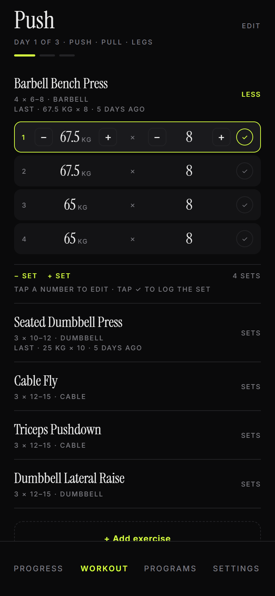
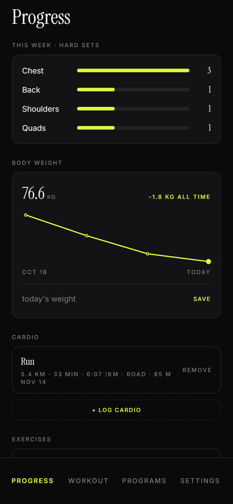
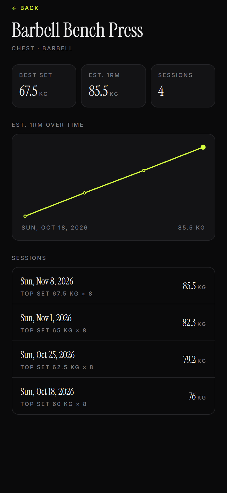
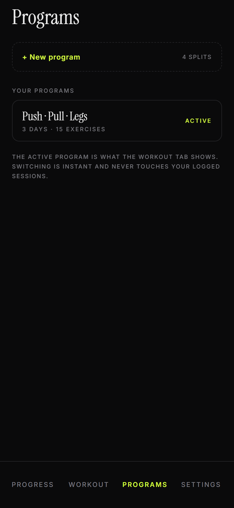

# Ledger

A local-first strength & cardio log for Android. Serif type, one accent colour,
no accounts, no cloud — everything lives in a single JSON document on your phone.

Built with Expo SDK 58 / React Native / TypeScript.



---

## Download the app

**➡️ [`releases/ledger-android-arm64.apk`](releases/ledger-android-arm64.apk)** (~45 MB, arm64-v8a — every phone made since ~2019)

1. Open the file on your phone (or `adb install`).
2. Android will ask to allow installing from this source — accept.
3. Launch **Ledger**. No sign-up, nothing to configure.

Prefer not to install an APK? Run it in [Expo Go](https://expo.dev/go) instead — see
[Run from source](#run-from-source).

---

## What it does

**Plan** — programs → days → exercises. Start from one of four splits
(Push·Pull·Legs, Upper·Lower, Chest·Back·Arms·Legs·Shoulders, Full body ×3) or build your
own: rename, duplicate, add/remove days, and set targets per exercise (sets, rep range,
rest override). One program is active at a time; switching never touches your history.

**Train** — one page per day, swipe between them. Tap a set's number to type the weight,
or nudge ±2.5 kg / ±1 rep; editing a value follows down to the sets below it. Prefill comes
from the last time you did that exercise (`LAST · 67.5 KG × 8 · 5 DAYS AGO`), and stale
history (over 8 weeks) is ignored rather than leading you astray.

**Rest** — the timer starts when you tick a set. `−15 / +15 / skip`, a scheduled
notification so it fires with the phone locked in your pocket, and vibration at zero.
Override the rest per exercise in the program editor.

**Review** — weekly hard sets per muscle group, per-exercise top set + estimated 1RM trend
(Epley), body-weight log with a sparkline, cardio entries, and every finished session in
detail. All charts are hand-drawn with `react-native-svg` — no chart library.

**Own it** — export a `.json` backup through the share sheet (Drive, Telegram, mail),
import it back with validation before anything is overwritten, or wipe everything with a
two-tap confirm. Export = backup = import format.

### Screens

| Progress | Exercise trend |
| --- | --- |
|  |  |

| Programs | Workout |
| --- | --- |
|  |  |

---

## Privacy

- No account, no analytics, no network requests. The app never talks to a server.
- Data is stored with `AsyncStorage` under `ledger-store-v1` and is portable via export.
- Rest-timer notifications are local (`expo-notifications`), never push.

---

## Run from source

Requirements: Node 20+, npm, and a phone with
[Expo Go](https://play.google.com/store/apps/details?id=host.exp.exponent) on the same Wi-Fi.

```bash
npm install
npx expo start --lan      # scan the QR code with Expo Go
```

Useful: `npx tsc --noEmit` typechecks the project.

---

## Build an APK

```bash
npx eas-cli@latest build -p android --profile preview
```

- `eas.json` has a `preview` profile: `buildType: apk`, internal distribution, and
  `reactNativeArchitectures=arm64-v8a` to keep the file small. Drop that `env` entry for a
  universal APK (all ABIs, ~114 MB).
- The project is linked to EAS as `@shubhammandiya/ledger`; the Android keystore lives on
  Expo's servers, so later builds install over earlier ones.
- **Windows note:** EAS archives with `git clone file:///C:/…`, which some Git builds can't
  resolve. Fix once with
  `git config --global url."file://C:/".insteadOf "file:///C:/"`. Details in
  [`DECISIONS.md`](DECISIONS.md).
- EAS ships **committed** state — commit before building.

---

## Project structure

```
src/
  app/                    expo-router routes
    (tabs)/index.tsx        Workout — day pager, set logging, rest timer
    (tabs)/progress.tsx     Progress — muscle sets, body weight, cardio, history
    (tabs)/programs.tsx     Programs — list, new-program sheet
    (tabs)/settings.tsx     Settings — theme, accents, backup, clear data
    program/[id].tsx        program editor (rename, duplicate, delete, days)
    day/[id].tsx            day editor (targets, add/remove exercises)
    exercise/[id].tsx       per-exercise 1RM trend
    session/[id].tsx        finished session detail
  domain/                 pure logic, no React
    types.ts                Program / Session / LoggedSet / CardioLog …
    seed.ts                 70 seeded movements + starter PPL program
    splits.ts               the four split templates
    history.ts              last-time lookup, prefill, formatting
    stats.ts                est. 1RM, sets per muscle, exercise series
    backup.ts               export document, parse + validate imports
  state/store.ts          zustand + AsyncStorage, one persisted document
  ui/                     theme tokens, type scale, tab bar, sheets, chart
  lib/                    rest notifications, backup I/O
docs/screens/             README screenshots
DECISIONS.md              product decisions, design system, gotchas
```

Hierarchy: **Program → Day → DayExercise (targets) → Session → LoggedSet**.
Sessions snapshot exercise names, so editing a program never rewrites history.

---

## Design system

- **Type:** Instrument Serif for titles, exercise names and every numeral (tabular figures);
  Inter for 9–11 px uppercase micro-labels. Bundled, so it works offline.
- **Night:** `#0A0A0B` canvas, `#EDEDED` text, lime `#D6FF3F` accent.
- **Day:** `#F7F6F3` canvas, `#111111` text, accent `#C9EA22` with a darker `accInk`
  for text so it stays readable on paper.
- Six accents (lime, rose, sky, amber, violet, mint), hairline rules instead of cards and
  shadows, 8 pt spacing grid.
- All tokens live in `src/ui/theme.ts`; screens never hardcode a colour or font name.

---

## Not included (deliberately)

Cloud accounts and sync, social features, Health Connect, GPS cardio, supersets/dropsets/RPE,
plate calculator, Play Store listing. Cardio is a one-line log by design.

---

## License

MIT — see [LICENSE](LICENSE).
